# 🤖 Awesome AI Agent Frameworks

**A curated, production-grade list of AI Agent Frameworks, Multi-Agent Orchestration Platforms, Autonomous Systems & SaaS Developer Tools.**

  <b>Explore top-tier multi-agent frameworks, autonomous web agents, stateful cyclic graphs, and enterprise agentic platforms.</b> 
  <i>Continuously tracked and updated for AI engineers, autonomous agent researchers, and LLM application developers.</i>

---

## 📑 Table of Contents

- [📊 Sector Overview & Market Dynamics](#-sector-overview--market-dynamics)
- [🏢 SaaS & Hosted Platforms](#-saas--hosted-platforms)
- [🔓 Open-Source GitHub Projects](#-open-source-github-projects)
- [💡 Architectural Archetypes & Choosing a Framework](#-architectural-archetypes--choosing-a-framework)
- [🤝 How to Contribute](#-how-to-contribute)
- [💖 Support](#-support)
- [⭐ Star History](#-star-history)
- [📜 Disclaimer](#-disclaimer)

---

## 📊 Sector Overview & Market Dynamics

The global **AI Agent & Autonomous Workflow market** is projected to grow from **~$8 billion in 2025 to over $52 billion by 2030**, reflecting a compound annual growth rate (**CAGR**) exceeding **45%**. 

The sector dynamics reveal a **dual-structured market**:
1. **Application & Workflow Layer (Moderately to Highly Fragmented):** Hundreds of innovative startups and community-led open-source frameworks compete to deliver vertical-specific workflows, visual builders, low-code canvases, and web automation tools.
2. **Infrastructure, Runtime & Foundation Layer (Highly Concentrated / Oligopoly):** Enterprise adoption increasingly relies on concentrated hyperscaler infrastructure (Microsoft Azure AI Foundry, AWS Bedrock, Google Cloud Vertex AI) and premier foundational model providers providing hosted tool-execution runtimes, fine-grained state persistence, and enterprise security guarantees.

---

## 🏢 SaaS & Hosted Platforms

The following commercial and enterprise platforms provide managed infrastructure, trace evaluation, visual builders, and production deployment environments for AI agents.

| 🚀 Platform | 💼 Company Valuation / Size | 💳 Starting Paid Tier Pricing | 🎁 Free Tier / Trial Limits | 📝 Description |
| :--- | :--- | :--- | :--- | :--- |
| **[Microsoft AutoGen / Azure AI Foundry Agent Service](https://learn.microsoft.com/en-us/azure/ai-studio/concepts/agent-service)** | $4.0+ Trillion Market Cap (Microsoft) | $0 platform fee (PAYGO compute at ~$0.05/container hr for custom hosted agents + model token consumption) | Free forever platform orchestration (No extra management fee; default quotas: up to 100k messages/thread, 128 tools/agent, 300GB storage; users bring own Azure credits or standard model quotas) | Enterprise-grade agent service supporting AutoGen and Microsoft Agent Framework with fully managed state, tool execution, and security. |
| **[Semantic Kernel / Azure AI](https://learn.microsoft.com/en-us/semantic-kernel/)** | $4.0+ Trillion Market Cap (Microsoft) | $0 SDK / Azure PAYGO model token consumption | 30-day Azure free trial with $200 credits; free SDK use with no seat fees (resource usage bounded only by Azure subscription quotas) | Enterprise SDK and cloud orchestration connecting LLM plugins, memories, and planner-driven agentic architectures. |
| **[Flowise](https://flowiseai.com/)** | ~$48 Billion Market Cap (Acquired by Workday) | $35/month (Starter tier) | Free forever plan: 2 flows/assistants, 100 predictions/month, 5 MB storage, and community support | Low-code / visual canvas interface to design and deploy agent chains, vector retrieval, and custom multi-agent logic. |
| **[LangChain / LangSmith](https://www.langchain.com/)** | $1.25 Billion Valuation (~$15M ARR) | $39/seat/month (Plus tier) | Free forever Developer plan: 1 user seat, 5,000 base traces/month (strictly hard-capped without credit card), 14-day data retention | Comprehensive LLMOps, evaluation, and observability control plane for AI agents and multi-agent chains. |
| **[LangGraph Platform](https://www.langchain.com/langgraph)** | $1.25 Billion Valuation (~$15M ARR; LangChain) | $39/seat/month (LangSmith Plus base + usage) | Free forever Developer plan: 1 user seat, 100,000 node executions/month, 1 local/self-hosted Lite deployment, 5,000 LangSmith traces | Managed cloud deployment, persistence layer, task queuing, and streaming server for cyclic, stateful multi-agent workflows. |
| **[Dify](https://dify.ai/)** | $180 Million Valuation ($30M Series Pre-A) | $59/workspace/month (Professional tier) | Free forever Sandbox plan: 1 team member, 200 system message credits, up to 5 apps, 50 MB knowledge base / 50 documents | Visual generative AI application platform and workflow builder for autonomous agents, RAG, and prompt management. |
| **[CrewAI Enterprise](https://www.crewai.com/)** | $50M - $100M Valuation ($18M funding) | $99/month (Starter / entry cloud tier; custom enterprise contracts from $6,000/year) | Free forever Basic plan: 1 user seat, 50 workflow executions/month, access to visual agent studio, guardrails, and templates | Managed orchestration workspace for defining, monitoring, and deploying role-based collaborative AI agent teams. |
| **[Haystack / deepset Studio](https://haystack.deepset.ai/)** | ~$46 Million Funding (~$12.5M ARR; deepset) | Custom enterprise licensing / AWS Marketplace contracts (contact sales) | Free forever Studio tier: 1 user, 1 workspace, 100 pipeline hours, 2 development pipelines, 50 files max (up to 10MB/file), 14-day logs | Enterprise platform and production suite built atop the open-source Haystack pipeline framework for RAG and agent systems. |
| **[SuperAGI Cloud](https://superagi.com/)** | $25M - $50M Valuation (~$12M funding) | $49/user/month (Pro plan) | Free forever plan: 100 AI credits/month, 2 outbound email agents, 20–25 prospects/day outreach cap, basic agentic CRM | Cloud-hosted autonomous agent workspace focused on self-directing workflow execution, sales prospecting, and tool-augmented agents. |

---

## 🔓 Open-Source GitHub Projects

The open-source AI agent ecosystem represents the most rapidly expanding area of developer innovation. Repositories below are equipped with live Stars_Count badges (linking directly to stargazers) and sorted strictly by **GitHub Stars_Count (descending)**.

- **[AutoGPT](https://github.com/Significant-Gravitas/AutoGPT)**   
  ⚡ The pioneering vision of autonomous AI agents: an open-source platform enabling developers to build, orchestrate, and run autonomous agents that break down high-level objectives into tasks and tool executions.

- **[Dify](https://github.com/langgenius/dify)**   
  ⚡ Production-grade open-source LLM application platform featuring an intuitive visual orchestration studio, agent assistants, complex RAG pipelines, and backend APIs.

- **[browser-use](https://github.com/browser-use/browser-use)**   
  ⚡ Make websites accessible for AI agents: enables autonomous browser interaction, web scraping, automated form completion, and complex web navigation with vision-driven models.

- **[OpenHands](https://github.com/All-Hands-AI/OpenHands)**   
  ⚡ A platform for software development agents capable of writing code, debugging, executing bash commands, reading documentation, and opening GitHub pull requests autonomously.

- **[MetaGPT](https://github.com/geekan/MetaGPT)**   
  ⚡ Multi-agent framework that encodes Standard Operating Procedures (SOPs) into software development teams: assign tasks to simulated Product Managers, Architects, Project Managers, and Engineers.

- **[Mem0](https://github.com/mem0ai/mem0)**   
  ⚡ The memory layer for personalized AI agents and assistants: enables stateful long-term recall, user preference persistence, and adaptive cross-session agent intelligence.

- **[AutoGen](https://github.com/microsoft/autogen)**   
  ⚡ Established multi-agent conversation framework by Microsoft enabling collaborative multi-agent workflows, code execution, and conversational problem-solving.

- **[CrewAI](https://github.com/crewAIInc/crewAI)**   
  ⚡ Cutting-edge framework for orchestrating role-playing autonomous AI agents. Foster collaborative intelligence by assembling crews with specialized skills, tools, and delegated goals.

- **[Flowise](https://github.com/FlowiseAI/Flowise)**   
  ⚡ Drag-and-drop visual UI builder for orchestrating LangChain components, agent tool callers, memory buffers, and custom LLM workflows.

- **[LlamaIndex](https://github.com/run-llama/llama_index)**   
  ⚡ Data framework for LLM applications with rich agentic workflows, query planners, retrieval-augmented generation (RAG) engines, and multimodal data connectors.

- **[LangGraph](https://github.com/langchain-ai/langgraph)**   
  ⚡ Low-level orchestration framework designed for robust, stateful, multi-actor LLM applications with cyclic graphs, checkpointing, branching, and human-in-the-loop interactions.

- **[Agno](https://github.com/agno-agi/agno)**   
  ⚡ Lightweight, high-speed Python library for building multimodal AI agents with memory, knowledge, and tools (formerly Phidata).

- **[DSPy](https://github.com/stanfordnlp/dspy)**   
  ⚡ Algorithmic framework for programming (rather than prompting) language models: automatically optimizes prompts, reasoning chains, and weight updates.

- **[GPT Researcher](https://github.com/assafelovic/gpt-researcher)**   
  ⚡ Autonomous agent tailored for comprehensive online research, crawling, fact-checking, and generating aggregated long-form research reports with citations.

- **[smolagents](https://github.com/huggingface/smolagents)**   
  ⚡ Hugging Face’s minimalist agent library: write code-driven agents in pure Python in just a few lines of code, focusing on simplicity, transparency, and raw speed.

- **[Semantic Kernel](https://github.com/microsoft/semantic-kernel)**   
  ⚡ Microsoft’s enterprise SDK supporting C#, Python, and Java for integrating AI capabilities, plugins, memory connectors, and agentic planners into corporate applications.

- **[Haystack](https://github.com/deepset-ai/haystack)**   
  ⚡ Composable, end-to-end open-source LLM framework by deepset focused on production-ready search, advanced RAG pipelines, and conversational agent tools.

- **[CAMEL](https://github.com/camel-ai/camel)**   
  ⚡ Communicative Agents for "Mind" Exploration: a scalable multi-agent framework exploring autonomous cooperation, communicative agent behaviors, and synthetic simulation.

- **[SuperAGI](https://github.com/TransformerOptimus/SuperAGI)**   
  ⚡ Autonomous AI agent infrastructure enabling developers to build, run, and manage multi-agent workflows with tool integration and agent telemetry.

- **[Microsoft Agent Framework](https://github.com/microsoft/agent-framework)**   
  ⚡ The next-generation, cross-language enterprise runtime from Microsoft unifying core ideas from AutoGen and Semantic Kernel into a production-first agentic foundation.

---

## 💡 Architectural Archetypes & Choosing a Framework

When architecting production agentic solutions, consider matching your application to the appropriate paradigm:

- 🚀 **Rapid Scripting & Minimalist Prototyping**: Choose **smolagents** or **Agno** when you want zero boilerplate and code-first execution in minimal lines of Python.
- 🔄 **Cyclic, Stateful & Complex Graph Workflows**: Choose **LangGraph** when you need fine-grained control over state graphs, cycles, branching, persistence, and human-in-the-loop approvals.
- 👥 **Role-Based Collaborative Teams**: Choose **CrewAI** or **MetaGPT** when your workflow mirrors organizational roles (e.g., researcher, writer, reviewer, developer).
- 🌐 **Web Automation & Browser Interaction**: Choose **browser-use** for autonomous UI exploration and dynamic web task automation.
- 📚 **Data Retrieval & RAG-Centric Agents**: Choose **LlamaIndex** or **Haystack** for deep document reasoning, complex retrieval strategies, and knowledge graph querying.
- 🎨 **Visual Builders & Low-Code Deployment**: Choose **Dify** or **Flowise** for rapid drag-and-drop configuration and multi-tenant cloud or self-hosted deployment.
- 🧠 **Programmatic Prompt Optimization**: Choose **DSPy** when you want programmatic compilation of prompt instructions and few-shot exemplars rather than brittle manual prompting.

---

## 🤝 How to Contribute

Contributions from the agentic AI community are warmly welcomed! 🌟

1. 🍴 **Fork the repository** on GitHub.
2. 🌿 **Create a new branch** (`git checkout -b feature/add-new-framework`).
3. 📝 **Add your framework or tool** in the appropriate section (following the existing badge and table formats). Ensure descriptions are accurate and concise.
4. 🚀 **Commit your changes** (`git commit -m 'Add AmazingFramework'`).
5. 📤 **Push to the branch** (`git push origin feature/add-new-framework`).
6. 📬 **Open a Pull Request** describing your additions.

---

## 💖 Support

If you find this repository valuable, please consider supporting the project:

- ⭐ **Star this repository** to help others discover it!
- 🍴 **Fork and contribute** to keep the list fresh and accurate.
- 📢 **Share with your network** on Twitter/X, LinkedIn, and Discord.
- ☕ **Buy a coffee & sponsor**: Support continuous maintenance and research via the [GitHub Sponsors Dashboard](https://github.com/sponsors/ishandutta2007).

---

##  Star History

---

## 📜 Disclaimer

- This is a **community-curated index** for informational and educational purposes — inclusion does not constitute an official endorsement.
- The AI agent landscape is evolving at breakneck speed; always evaluate software licenses, operational safety rails, and enterprise security policies before deploying autonomous agents in production environments.

---

  Built with ❤️ for AI engineers, autonomous agent creators, and open-source researchers worldwide.

